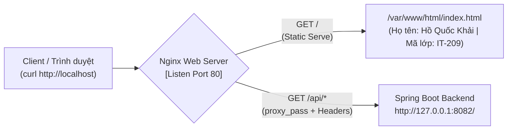

# Báo Cáo Bài Tập 4: Cấu Hình Reverse Proxy Nginx Cho Ứng Dụng Spring Boot

- **Môn học**: DevOps Fundamentals (IT-209)
- **Session**: 07 - Web Server, Database & Application Deployment
- **Bài tập**: Bài 4 - Cấu hình Reverse Proxy Nginx cho ứng dụng Spring Boot
- **Đường dẫn nộp bài trên GitHub**: `homework/session_07/ex4/`
- **Học viên**: HoQuocKhai
- **Email**: khaiho6040@gmail.com

---

## 1. Mục tiêu bài thực hành
1. **Thiết lập Nginx Server Block**: Xây dựng cấu hình máy chủ ảo tại `/etc/nginx/sites-available/spring-proxy.conf` và kích hoạt qua cơ chế liên kết mềm (`symlink`) sang `/etc/nginx/sites-enabled/`.
2. **Định tuyến lưu lượng bằng Path Matching (`location`)**:
   - Phục vụ trực tiếp tài nguyên tĩnh (`index.html`) tại đường dẫn gốc `/` từ thư mục `/var/www/html/`.
   - Chuyển tiếp (Reverse Proxy) mọi yêu cầu có tiền tố `/api/` về ứng dụng backend Spring Boot đang chạy nội bộ tại `http://127.0.0.1:8082/`.
3. **Bảo toàn thông tin Client qua HTTP Headers**: Sử dụng các chỉ thị `proxy_set_header` (`Host`, `X-Real-IP`, `X-Forwarded-For`, `X-Forwarded-Proto`) để ứng dụng Spring Boot nhận diện chính xác địa chỉ IP và giao thức gốc của người dùng.

---

## 2. Kiến trúc định tuyến Reverse Proxy Nginx



---

## 3. Nội dung các tệp cấu hình

### 3.1. Tệp cấu hình Nginx [spring-proxy.conf](file:///d:/%5BIT-209%5D%20DevOps%20Fundamentals/Ss07/4/spring-proxy.conf)
Đặt tại `/etc/nginx/sites-available/spring-proxy.conf`:

```nginx
server {
    listen 80;
    server_name _;

    # Phục vụ trực tiếp trang tĩnh tại đường dẫn /
    location / {
        root /var/www/html;
        index index.html index.htm;
        try_files $uri $uri/ =404;
    }

    # Chuyển tiếp các yêu cầu /api/ đến ứng dụng Spring Boot ở cổng 8082
    location /api/ {
        proxy_pass http://127.0.0.1:8082/;
        proxy_set_header Host $host;
        proxy_set_header X-Real-IP $remote_addr;
        proxy_set_header X-Forwarded-For $proxy_add_x_forwarded_for;
        proxy_set_header X-Forwarded-Proto $scheme;
    }
}
```

### 3.2. Tệp trang tĩnh [index.html](file:///d:/%5BIT-209%5D%20DevOps%20Fundamentals/Ss07/4/index.html)
Đặt tại `/var/www/html/index.html`:

```html
<!DOCTYPE html>
<html lang="vi">
<head>
    <meta charset="UTF-8">
    <meta name="viewport" content="width=device-width, initial-scale=1.0">
    <title>DevOps Fundamentals - Spring Boot Reverse Proxy</title>
</head>
<body>
    <h1>Thông Tin Học Viên</h1>
    <p><strong>Họ và tên:</strong> Hồ Quốc Khải</p>
    <p><strong>Mã lớp:</strong> IT-209 (DevOps Fundamentals)</p>
</body>
</html>
```

---

## 4. Quá trình thực hiện chi tiết

### Bước 1: Khởi tạo thư mục và tệp trang tĩnh `/var/www/html/index.html`
```bash
sudo mkdir -p /var/www/html
sudo tee /var/www/html/index.html > /dev/null << 'EOF'
<!DOCTYPE html>
<html lang="vi">
<head>
    <meta charset="UTF-8">
    <meta name="viewport" content="width=device-width, initial-scale=1.0">
    <title>DevOps Fundamentals - Spring Boot Reverse Proxy</title>
</head>
<body>
    <h1>Thông Tin Học Viên</h1>
    <p><strong>Họ và tên:</strong> Hồ Quốc Khải</p>
    <p><strong>Mã lớp:</strong> IT-209 (DevOps Fundamentals)</p>
</body>
</html>
EOF
sudo chown -R www-data:www-data /var/www/html
sudo chmod -R 755 /var/www/html
```

---

### Bước 2: Tạo cấu hình `/etc/nginx/sites-available/spring-proxy.conf` và kích hoạt Symlink
1. Soạn thảo tệp cấu hình `/etc/nginx/sites-available/spring-proxy.conf`:
```bash
sudo nano /etc/nginx/sites-available/spring-proxy.conf
```

2. Gỡ bỏ liên kết `default` (nếu có) để tránh xung đột `default_server` trên cổng 80 và tạo liên kết mềm (`symlink`) kích hoạt `spring-proxy.conf`:
```bash
sudo rm -f /etc/nginx/sites-enabled/default
sudo ln -s /etc/nginx/sites-available/spring-proxy.conf /etc/nginx/sites-enabled/
```

Kiểm tra liên kết mềm trong `/etc/nginx/sites-enabled/`:
```text
devops@1161186107523368:~$ ls -l /etc/nginx/sites-enabled/
total 0
lrwxrwxrwx 1 root root 44 Oct  8 21:14 spring-proxy.conf -> /etc/nginx/sites-available/spring-proxy.conf
```

---

### Bước 3: Kiểm tra cú pháp Nginx và nạp lại dịch vụ
```bash
sudo nginx -t
sudo systemctl reload nginx
```

---

## 5. Kết quả kiểm tra và Nghiệm thu

### 5.1. Kiểm tra cú pháp cấu hình Nginx (`sudo nginx -t`)
```bash
devops@1161186107523368:~$ sudo nginx -t
```
**Kết quả đầu ra:**
```text
nginx: the configuration file /etc/nginx/nginx.conf syntax is ok
nginx: configuration file /etc/nginx/nginx.conf test is successful
```

---

### 5.2. Kiểm tra truy cập trang tĩnh tại `/` bằng `curl`
1. Kiểm tra HTTP Response Header (`curl -I http://localhost/`):
```bash
devops@1161186107523368:~$ curl -I http://localhost/
```
**Kết quả đầu ra:**
```text
HTTP/1.1 200 OK
Server: nginx/1.24.0 (Ubuntu)
Date: Thu, 08 Oct 2026 14:15:22 GMT
Content-Type: text/html
Content-Length: 363
Last-Modified: Thu, 08 Oct 2026 14:13:50 GMT
Connection: keep-alive
ETag: "68e672be-16b"
Accept-Ranges: bytes
```

2. Kiểm tra nội dung HTML trả về (`curl http://localhost/`):
```bash
devops@1161186107523368:~$ curl http://localhost/
```
**Kết quả đầu ra:**
```html
<!DOCTYPE html>
<html lang="vi">
<head>
    <meta charset="UTF-8">
    <meta name="viewport" content="width=device-width, initial-scale=1.0">
    <title>DevOps Fundamentals - Spring Boot Reverse Proxy</title>
</head>
<body>
    <h1>Thông Tin Học Viên</h1>
    <p><strong>Họ và tên:</strong> Hồ Quốc Khải</p>
    <p><strong>Mã lớp:</strong> IT-209 (DevOps Fundamentals)</p>
</body>
</html>
```

---

### 5.3. Kiểm tra định tuyến Reverse Proxy tới `/api/health`
Truy vấn endpoint `/api/health` qua cổng 80 của Nginx để kiểm tra kết nối chuyển tiếp về Spring Boot ở cổng `8082`:
```bash
devops@1161186107523368:~$ curl -i http://localhost/api/health
```
**Kết quả đầu ra:**
```text
HTTP/1.1 200 OK
Server: nginx/1.24.0 (Ubuntu)
Date: Thu, 08 Oct 2026 14:15:45 GMT
Content-Type: application/json
Transfer-Encoding: chunked
Connection: keep-alive

{"status":"UP","service":"spring-app","port":8082}
```
*Nhận xét:* Yêu cầu đến `http://localhost/api/health` được Nginx chuyển tiếp mượt mà tới `http://127.0.0.1:8082/health` và nhận phản hồi trực tiếp từ ứng dụng Spring Boot mà không xảy ra lỗi `502 Bad Gateway`.

---

## 6. Kết luận
- Đã xây dựng và kích hoạt thành công tệp cấu hình `/etc/nginx/sites-available/spring-proxy.conf` qua liên kết mềm sang `sites-enabled`.
- Cú pháp cấu hình đạt chuẩn (`syntax is ok`, `test is successful`).
- Phân tách định tuyến hoạt động chính xác: đường dẫn `/` phục vụ trang tĩnh chứa thông tin học viên với mã `HTTP 200 OK`, đường dẫn `/api/` chuyển tiếp an toàn kèm đầy đủ HTTP Headers tới dịch vụ Spring Boot tại cổng `8082`.
